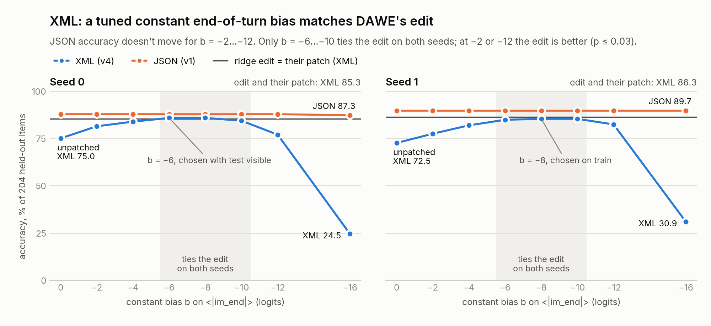
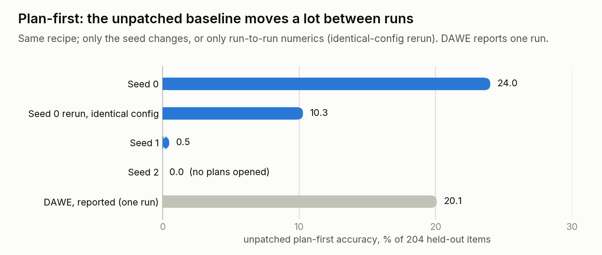

# bias-dawe

Controls for [DAWE](https://github.com/bandr-ai/dawe): does a constant logit bias do what its weight edits do?

DAWE repairs tool-call format breaks in a fine-tuned Qwen3.5-4B by writing a ridge-regression fit into one or two rows of the output embedding. This repo re-runs their recipe on two fine-tuning seeds and compares the edits against constant logit biases and same-norm random edits.

<picture>
  <source media="(prefers-color-scheme: dark)" srcset="figures/xml_bias_dark.png">
  
</picture>

## Results

Accuracy (%) on 204 held-out BFCL items per harness. `a/b` counts items only the first arm gets right and items only the second gets right (exact McNemar test). At n = 204, differences under about 4 points are within noise.

**XML harness** (XML / JSON)

| | Seed 0 | Seed 1 |
|---|---|---|
| Unpatched | 75.0 / 87.7 | 72.5 / 89.7 |
| Ridge edit, DAWE settings | 85.3 / 87.3 | 86.3 / 89.7 |
| DAWE's released patch | 85.3 / 87.3 | 86.3 / 89.7 |
| Constant bias on `<\|im_end\|>` | 85.8 / 87.7 (b = −6) | 85.3 / 89.7 (b = −8) |
| Same-norm random edit | 67.6 / 87.7 | not run |

**Plan-first harness** (plan-first / JSON)

| | Seed 0 | Seed 1 |
|---|---|---|
| Unpatched | 24.0 / 87.7 | 0.5 / 89.7 |
| Two-row edit, DAWE settings | 88.7 / 87.3 | 57.4 / 89.7 |
| DAWE's released patch | 89.2 / 87.3 | 55.4 / 89.2 |
| First-token bias, c = +8 | 88.2 / 87.3 | 58.3 / 89.7 |
| Bias on `<` at every position | 87.7 / 87.7 | 50.0 / 89.7 |
| Same-norm random edit | 10.3 / 87.7 | 0.0 / 89.7 |

**Unpatched baselines across runs of the same recipe**

| | JSON | XML | XML multi-call (n = 48) | Plan-first |
|---|---:|---:|---:|---:|
| Seed 0 | 87.7 | 75.0 | 33.3 | 24.0 |
| Seed 0, identical-config rerun | 87.3 | 72.1 | 22.9 | 10.3 |
| Seed 1 | 89.7 | 72.5 | 20.8 | 0.5 |
| Seed 2 | 90.2 | 80.4 | 56.2 | 0.0 |
| DAWE, reported (one run) | 87.7 | 73.5 | 25.0 | 20.1 |
| Base model | 71.6 | 81.9 | 70.8 | 11.3 |

<picture>
  <source media="(prefers-color-scheme: dark)" srcset="figures/planfirst_baseline_dark.png">
  
</picture>

## Findings

- **XML.** A constant bias on `<|im_end|>` matches the ridge edit on both seeds (0/1 and 4/2; 194/204 identical outputs on seed 1). On both seeds it matches only for b between −6 and −10 (−4 also matches on seed 0); at −2 or −12 the edit is better by 3.9–8.8 points (p ≤ 0.03).
- **Strength.** Both methods were tuned. DAWE tried four strengths for the XML edit on train (6, 8, 12, 16) and kept 12, which is used here; those score 93.3–93.9 on train XML in DAWE's logs (their checkpoint). The seed-1 bias scores 87.9–95.0 on train over −6 to −12. The edit looks less sensitive to strength, but it was not swept on these checkpoints.
- **Plan-first.** A +8 bias on `<` at the first reply token, plus a bias on `<|im_end|>`, matches the two-row edit on both seeds (3/2 and 6/8). The same bias applied at every position loses on seed 1 (20/5, p = 0.004). Re-tuned to +12 for seed 1, the first-token bias reaches 65.2 against the edit's 57.4; the edit's +8 target was not re-tuned.
- **The edit's advantages.** It is a single weight patch, and needs no serving code. It scores 1.5–2.9 points above the plan-first biases on XML in all four comparisons, each within the 4-point noise margin. On seed 0 DAWE's one-row patch beats the end-of-turn bias on plan-first (17/2, p = 0.0007); the one-row fit made here does not (12/5, p = 0.14), and neither does on seed 1.
- **Transfer.** The row deltas from DAWE's released patches, added to these fine-tunes, match fits made on them on each patch's own harness.
- **Baseline variance.** Unpatched plan-first accuracy ranges from 0.0 to 24.0 across runs of the same recipe. An identical-config rerun of seed 0 drops it from 24.0 to 10.3. DAWE's 20.1 comes from a single run.

## Setup

| | |
|---|---|
| Model | `Qwen/Qwen3.5-4B`, revision `851bf6e8` |
| Fine-tuning | DAWE's recipe: LoRA r = 32, α = 64 on all linear layers; AdamW, lr 1e-4; 3 epochs; batch 16 |
| Data | BFCL v3 simple, multiple and parallel; DAWE's split, 595 train / 204 test |
| Harnesses | JSON (`v1`), XML (`v4_format`), plan-first (`v11_plan`) |
| Decoding | vLLM 0.31, greedy |
| Scoring | DAWE's per-item matcher |
| Edits | Ridge fits with DAWE's settings (λ = 0.01 · mean diag XᵀX). DAWE chose the strengths on train (four XML candidates, two plan-first); not re-selected here |
| Biases | vLLM `logit_bias`; the first-token bias is a two-pass decode |
| Bias selection | Chosen on train items by rules written before scoring test (`prereg/`), except the seed-0 XML bias, chosen with test visible; the seed-1 +12 was set from train margins after its +8 test score was known |
| Seeds | Edits and controls on seeds 0 and 1; seed 2 and the rerun are baselines only |
| Compute | Modal H100, about $11 |

## Reproduce

Tables and figures from the committed per-item results (no GPU):

```bash
python3 tools/tables.py
python3 tools/make_figures.py
```

Full runs on Modal:

```bash
cd code
modal run formatter_exps_gp.py::prefetch
modal run formatter_exps_gp.py::stage1 --run sft_v1_s0 --seed 0   # fine-tune seed 0, unpatched eval
modal run prevent.py::arm --name a1                                # fine-tune seed 1, unpatched eval
modal run formatter_exps_gp.py::state_map --run sft_v1_s0          # hidden states for the ridge fits
modal run formatter_exps_gp.py::stage2                             # XML arms, seed 0
modal run formatter_exps_gp.py::s1_merge_map
modal run formatter_exps_gp.py::stage2_s1                          # XML arms, seed 1
modal run formatter_exps_gp.py::s3_merge_planmap
modal run formatter_exps_gp.py::stage3                             # plan-first arms, both seeds
modal run formatter_exps_gp.py::step2 --runs-spec sft_v1_s0r:0,sft_v1_s2:2
```

Score predictions with DAWE's scorer (`bandr-ai/dawe` at `8f11c96`): `DAWE_REPO=<checkout> code/scoring/score_stage2.sh runs/stage2`. [results/README.md](results/README.md) maps each result file to a table.

## Limitations

- One model, one recipe, 204 test items per harness. Both seeds are scored on the same items.
- The biases are decode-time and need tuning. The plan-first bias also needs serving code that knows where the reply starts.
- Side effects were measured only on the three tool-call harnesses.
- These fine-tunes are not DAWE's (theirs is unpublished), and GPU training is not bit-reproducible.

## Also in this repo

- `results/prevent/`: training the decision-token output rows during fine-tuning makes the XML break worse (items fixed/broken within the same weights: 0/10 on seed 0, 3/14 on seed 1).
- `code/margins/`: logit margins at the decision points.

## License

Apache-2.0. The training, generation and hidden-state code is adapted from DAWE (Apache-2.0); see [NOTICE](NOTICE). The data is derived from the [Berkeley Function Calling Leaderboard](https://huggingface.co/datasets/gorilla-llm/Berkeley-Function-Calling-Leaderboard) v3 (Apache-2.0).
